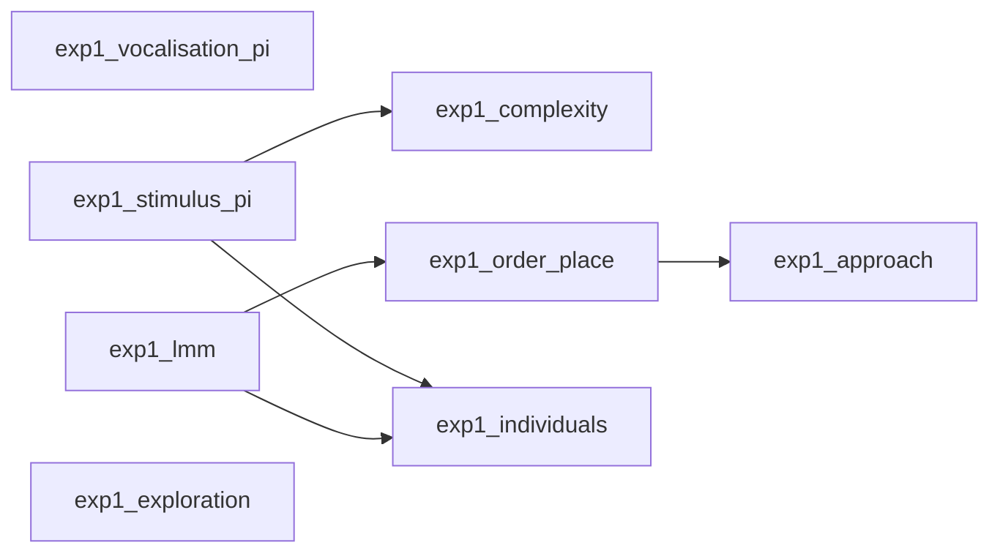
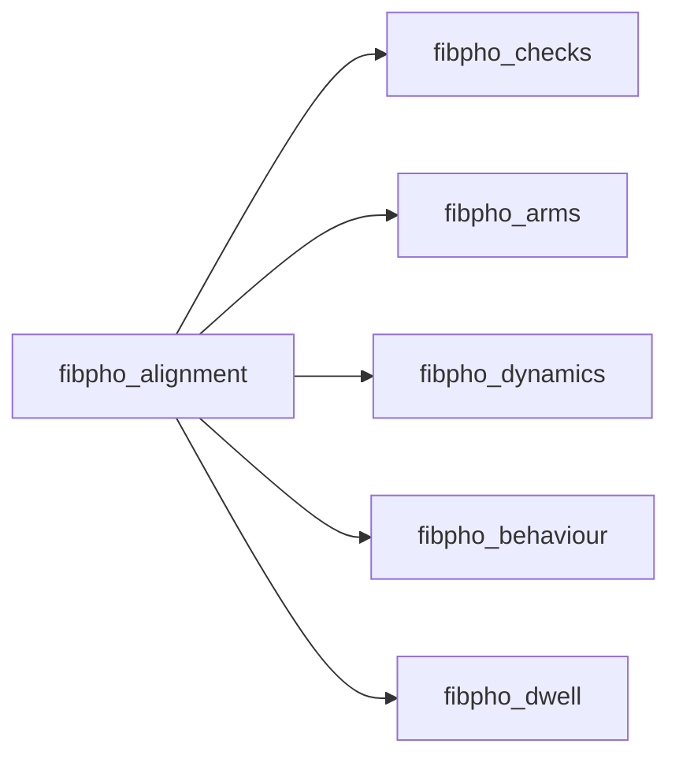

# Auditory analysis pipelines

Everything here lives under `analysis/auditory/`. The scripts are standalone research code, not part of the installed package: each takes a data folder, reads the session logs and writes its tables, statistics and figures to a folder of its own.

There are two generations of scripts.

- **The thesis analyses**, named by experiment (`exp1_*`, `exp2_*`, `fibpho_*`, `pilot_four_arm.py`). These produce every number and figure in the thesis, and they are the ones to use for anything you report.
- **The earlier batch pipeline** (`01_preference_analysis.py`, `run_batch_preference.py` and the rest), kept for reference and described at the end of this page.

The code that recorded the thesis data is tagged [`v1.0-thesis`](https://github.com/MaravallLab/aMAZEing-maze/releases/tag/v1.0-thesis).

## Before you start

### Requirements

```bash
pip install -e ".[analysis]"
```

Some scripts need more than Python:

| For | You also need |
|---|---|
| `exp1_lmm.py`, `exp1_approach.py`, `exp2_lmm.py` | R 4 with `lme4`, `lmerTest` and `emmeans`. The scripts look for `Rscript` on the PATH, then in the newest R under `C:/Program Files/R`. |
| `model_validation/` (Experiment 2 Bayesian fits) | PyMC and ArviZ, at the versions pinned in its [quick guide](https://github.com/MaravallLab/aMAZEing-maze/blob/main/analysis/auditory/model_validation/QUICKGUIDE.md) |
| `fibpho_alignment.py`, `fibpho_checks.py` | The `tdt` package, to read Tucker-Davis tanks |

### Data layout

```
<data root>/
  8_arms_w_voc/            Experiment 1, one folder per stimulus set
    w1_d1/                   day 1: temporal envelope modulation
    w1_d2/ w1_d3/ w1_d4/     days 2 to 4: musical intervals
    w2_sequences/            day 5: tone sequences
    w2_vocalisations/        day 6: recorded vocalisations
  grammar/                 Experiment 2: training and test days
  dopamine recordings/     photometry: TDT tanks, and the maze sessions recorded with them
  vocalisationzzzzzz/      the vocalisation recordings the maze played
  time_..._mouseN/         the four-arm pilot sessions, loose at the top
```

Every script takes its data folder as the first argument. Without one, the Experiment 1 scripts use `MAZE_DATA_DIR` (or the default in `preference_analysis_config.py`), and the photometry scripts use `MAZE_PHOTOMETRY_DIR`.

### Conventions shared by every script

**Outputs never go into the session folders.** Each script writes to `<data folder>/BATCH_ANALYSIS/<its name>/`. With `--thesis-figures DIR` it also writes the thesis version of its figures, in the thesis fonts and sizes, into `DIR`.

**The preference index** is the one defined in the thesis, on mean visit length, with both arms taken from the same sound blocks:

```
PI = (mean visit with a - mean visit with b) / (mean visit with a + mean visit with b)
```

from -1 (only b) to +1 (only a). Visits are not capped. The earlier pipeline capped every visit at 10 s to absorb a logging fault, which also shortened genuine long stays; `exp1_vocalisation_pi.py` computes both, so the effect of the cap can be seen.

**The first sound block keeps the listed order.** By design, the first sound block of every session places each stimulus in the arm its place in the list gives it, and only the later blocks are reshuffled. In block 1, then, a stimulus and a place go together. The Experiment 1 scripts that compare stimuli take `--shuffled-only`, which refits everything on blocks 2 to 4 and writes to `<name>_shuffled/`. The Experiment 2 scripts report blocks 2 to 4, all four blocks and block 1 alone.

**Exclusions are printed when a script runs**, with the reason for each.

## Experiment 1: eight arms, six stimulus sets



| Script | Question | Writes to `BATCH_ANALYSIS/` |
|---|---|---|
| `exp1_vocalisation_pi.py` | Do mice prefer the vocalisation to silence, the synthetic sounds to silence, and the vocalisation to the synthetic sounds? Per day, capped and uncapped. | `vocalisation_pi/` |
| `exp1_stimulus_pi.py` | Each stimulus against the silent arm; consonant against dissonant intervals; rough against smooth envelopes. | `stimulus_pi/` |
| `exp1_complexity.py` | Does preference follow spectral or temporal complexity, in a line or an inverted U? Also within the seven recordings of the vocalisation day, by spectral and temporal entropy. Run `exp1_stimulus_pi.py` first. | `complexity/` |
| `exp1_lmm.py` (calls `exp1_lmm.R`) | Mixed models of visit length: class by set, consonance, roughness, modulation. Writes the arm-by-block table the next two scripts read. | `lmm/` |
| `exp1_order_place.py` | Day order against habituation, and place bias: the three indices (synthetic against silent, vocalisation against synthetic, vocalisation against silent) block by block, arm shares in habituation and sound blocks, the usual silent arm, first entries. | `order_place/` |
| `exp1_approach.py` (calls `exp1_approach.R`) | Entering against staying: entries per arm and mean visit length, with a Poisson mixed model of the entries. | `approach/` |
| `exp1_exploration.py` | Does exploratory drive in the silent habituation block go with engagement with the sounds? | `exploration/` |
| `exp1_bd_model.py` | Does the model of Brielmann and Dayan, with each stimulus described only by its measured spectral and temporal complexity, account for the index of every stimulus on every day, and does it single out the vocalisation? Nested models (intercept, vocalisation only, fluency, Brielmann and Dayan, the same with the expected world fixed at the centre, and with an extra value for a vocalisation) fitted by least squares and compared by AIC and by predicting each left out day. Run `exp1_stimulus_pi.py`, `exp1_complexity.py` and `exp1_lmm.py` first. | `bd_model/` |
| `exp1_individuals.py` (calls `exp1_individuals.R`) | How the averages divide among the mice: each stimulus against silence in a mixed model beside the mice; every mouse's index for every stimulus and day; the vocalisation day by day, mouse by mouse; how the variance of the index divides between the day, the stimulus, the mouse and the session, with and without the silent arm's own visits; the share between mice of three indices; principal components of what each session did. Run `exp1_stimulus_pi.py` and `exp1_lmm.py` first. | `individuals/` |

```bash
cd analysis/auditory
python exp1_vocalisation_pi.py D:/AuditoryExperiments/8_arms_w_voc
python exp1_stimulus_pi.py     D:/AuditoryExperiments/8_arms_w_voc
python exp1_complexity.py      D:/AuditoryExperiments/8_arms_w_voc
python exp1_lmm.py             D:/AuditoryExperiments/8_arms_w_voc
python exp1_order_place.py     D:/AuditoryExperiments/8_arms_w_voc
python exp1_approach.py        D:/AuditoryExperiments/8_arms_w_voc
python exp1_exploration.py     D:/AuditoryExperiments/8_arms_w_voc
python exp1_individuals.py     D:/AuditoryExperiments/8_arms_w_voc
python exp1_bd_model.py        D:/AuditoryExperiments/8_arms_w_voc
```

Add `--shuffled-only` to `exp1_stimulus_pi.py`, `exp1_complexity.py` and `exp1_lmm.py` for blocks 2 to 4 alone.

The second part of `exp1_complexity.py` reads the vocalisation recordings themselves. It looks for them in the folders listed in `VOCALISATION_FOLDERS` at the top of the script, and skips that part if none exists; add a line for your computer.

## Experiment 2: the grammar experiment

| Script | What it does | Writes to `BATCH_ANALYSIS/` |
|---|---|---|
| `exp2_lmm.py` (calls `exp2_lmm.R`) | The session-level preference for the grammar heard in the enriched cage over the one heard in the standard cage, block by block and per mouse, with place controlled; mixed models with the arm as a random effect. | `exp2/` |
| `exp2_figures.py` | The thesis figures of the stimuli, the session-level preference and the model. Run `exp2_lmm.py` first. | thesis figures only |
| `exp2_model_check.py` | Could place alone produce the semantic weight? And the ladder of models (original, sequential, full), cross-validated. | `exp2_model/` |
| `exp2_model_compare.py` | AIC and BIC for the four nested value models (intercept, fluency, Brielmann and Dayan, full), at the grain of the session. | `exp2_model/` |
| `model_validation/` | The Bayesian fits of the value model (PyMC): recovery, model comparison by leave-one-out, posterior predictive checks, grains of observation. See its [quick guide](https://github.com/MaravallLab/aMAZEing-maze/blob/main/analysis/auditory/model_validation/QUICKGUIDE.md). | an output folder you choose |

```bash
cd analysis/auditory
python exp2_lmm.py           D:/AuditoryExperiments/grammar
python exp2_figures.py       D:/AuditoryExperiments/grammar --thesis-figures <thesis>/figures
python exp2_model_check.py   D:/AuditoryExperiments/grammar
python exp2_model_compare.py D:/AuditoryExperiments/grammar
```

The `exp2_*` scripts read `model_validation/` (its data loading, exclusions and features) but never change it or its outputs, so the earlier analysis stays reproducible as it was.

## Stimulus measures

`stimulus_complexity.py` holds the measures of how complex a stimulus is. Run on its own, it prints a worked table.

| Measure | What it is |
|---|---|
| Spectral complexity | The normalised entropy of the power spectrum, 0 to 96 kHz: about 0.10 for a pure tone, near 1 for noise |
| Temporal complexity | The cycles of the lowest frequency before the waveform repeats, in bits (log2): 0 for a pure tone, log2 q for an interval p/q |
| Temporal entropy | How evenly a sound's energy is spread over time, in 5 ms frames (after Sueur et al. 2008), for recordings, which never repeat |

`complexity_3d.py` draws Figures 3.4 and 4.12 in three dimensions with plotly, so the view can be turned with the mouse. Each stimulus sits at its temporal and spectral complexity and is raised to how the mice treated it. A menu switches the height between the share of the time in the arms spent on the stimulus's arm (chance 25% in the pilot, 12.5% in Experiment 1) and the preference index against the silent arm. Run `pilot_four_arm.py`'s survey and `exp1_complexity.py` first. It writes `pilot/pilot_complexity_3d.html` and `complexity/exp1_complexity_3d.html`, pages that open without a connection, and the numbers the thesis quotes from these views to `complexity/stats_3d.txt` (the shares by kind of stimulus, the shares of the silent and vocalisation arms, and the complex tones of the envelope day against the smooth and rough ones); `--gallery DIR` also writes each view as JSON for a page that loads plotly itself, and `--thesis-figures DIR` writes the time on the arm view of each as a still image, through `kaleido` (`pip install kaleido`, which drives an installed Chrome).

```bash
python analysis/auditory/complexity_3d.py
```

## The four-arm pilot

The sessions recorded before the eight-arm protocol sit loose at the top of the data folder, written by several versions of the code.

```bash
python analysis/auditory/survey_standalone_sessions.py --root D:/AuditoryExperiments
python analysis/auditory/pilot_four_arm.py
```

`survey_standalone_sessions.py` reads every session on its own terms and writes `sessions.csv` and `blocks.csv` to a folder beside the data (by default `D:/AuditoryExperiments_survey`). `pilot_four_arm.py` describes the three cohorts from those tables, with every figure showing each mouse, and tests them as the thesis does for Experiment 1. Wilcoxon signed rank tests across mice (Holm within a family) cover sound against silent blocks, the arm each mouse favoured before any sound, the indices of the interval sessions and the consonant against dissonant pairs; a mixed model relates the index to temporal complexity. The mixed models of entries and visit length run in R (`pilot_lmm.R`, with lme4, lmerTest and emmeans). The numbers go to `pilot/stats.txt` and `pilot/lmm_results.txt`. With two to five mice per cohort the cohorts are pooled, and the tests describe these animals rather than mice in general.

## Photometry

Dopamine recordings (Tucker-Davis) made during maze sessions. `fibpho_alignment.py` runs first; the rest read what it saves.



Expected layout:

```
dopamine recordings/
  dopaminergic recordings/        one TDT block (tank) per recording
  temporal_envelope_modulation/   one folder per experiment day, holding the maze sessions
  intervals/
  sequences/
  vocalisations/
```

**How the alignment works.** The TDT system and the maze keep separate clocks. The maze sends a TTL pulse on every sound, and every difference between a logged sound onset and a TTL onset is a candidate offset between the clocks; the true offset is the one most of them share, so stray pulses (tests sent before the session, a restarted session) do not move it. The block with the most matched pulses is the session's own. Delta F/F divides each channel by a double exponential fitted to remove bleaching, then corrects the 465 nm signal with the 405 nm isosbestic channel, fitted separately within each block. Every arm entry becomes an event, timed by its TTL where one matched and by its logged onset otherwise.

| Script | What it does | Writes to `FIBPHO_ANALYSIS/` |
|---|---|---|
| `fibpho_alignment.py` | Aligns every recording with its session; delta F/F; overview, block and peri-event figures | `<day>/<mouse>/`, `alignment_summary.csv` |
| `fibpho_checks.py` | Entries against random moments; each channel on its own; whether 405 nm is a clean motion reference | `checks/` |
| `fibpho_arms.py` | Dopamine while the mouse is in each arm, against the behavioural preference for it | `arms/` |
| `fibpho_dynamics.py` | How the response changes within blocks, across blocks and from arm to arm | `dynamics/` |
| `fibpho_behaviour.py` | Dopamine by where the mouse was (arm, entrance, outside); the response to each stimulus from first to last exposure | `behaviour/` |
| `fibpho_dwell.py` | Dopamine before, during and after each visit, against how long the mouse stayed; every long visit on its own; the time course around a visit for every stimulus of every day, with each stay stretched to one width (`fig_psth`, tests in `stats_psth.txt`); the complex tones of the envelope day against the smooth and rough ones, in entries, time and dopamine (`fig_complex`) | `dwell/` |

```bash
cd analysis/auditory
python fibpho_alignment.py "D:/AuditoryExperiments/dopamine recordings"
python fibpho_checks.py    "D:/AuditoryExperiments/dopamine recordings"
python fibpho_dwell.py     "D:/AuditoryExperiments/dopamine recordings/FIBPHO_ANALYSIS"
```

`fibpho_arms.py`, `fibpho_dynamics.py` and `fibpho_behaviour.py` take the same `FIBPHO_ANALYSIS` folder as `fibpho_dwell.py`.

With two mice, every photometry test is within these two animals; nothing here generalises to mice.

## The earlier batch pipeline

These scripts came before the thesis analyses and are kept so that earlier results can be reproduced. They cap every visit at 10 s, and the 4D aesthetic value model below is not the model of the thesis. For a technical report on that model, see [`analysis/auditory/REPORT_aesthetic_value_model.md`](https://github.com/MaravallLab/aMAZEing-maze/blob/main/analysis/auditory/REPORT_aesthetic_value_model.md).

**Prerequisites:**

```bash
pip install numpy pandas matplotlib seaborn scipy statsmodels plotly
```

**Expected data layout:**

```
8_arms_w_voc/
  w1_d1/                            # Day 1: temporal envelope modulation
    time_2025-06-04_14_22_30mouse10049/
      trials_time_2025-06-04_14_22_30.csv
      mouseXXXXX_..._detailed_visits.csv   # optional ground-truth log
    ...
  w1_d2/                            # Day 2: consonant/dissonant intervals
  w1_d3/                            # Day 3: consonant/dissonant intervals
  w1_d4/                            # Day 4: intervals (no silent control)
  w2_sequences/                     # Week 2: tone sequences
  w2_vocalisations/                 # Week 2: mouse vocalisations
```

**Configuration:**

Edit `preference_analysis_config.py`:
- `BASE_PATH` -- root folder containing `w1_d1/`, `w1_d2/`, etc.
- Or set the `MAZE_DATA_DIR` environment variable to override.
- `VISIT_CLIP_MS` env var -- per-visit duration cap in ms (default 10000).

**Running:**

```bash
cd analysis/auditory
# Verify session discovery first:
python preference_analysis_config.py

# Option A: standalone single-pipeline run (no batch summary CSV):
python 01_preference_analysis.py

# Option B (recommended): full batch analysis (generates all CSVs + figures + stats,
# automatically calls 02_within_trial_preference.py at the end):
python run_batch_preference.py

# Optional: completers-only linear mixed model on the batch CSV
# (run AFTER run_batch_preference.py so preference_data.csv exists):
python 03_completers_lmm.py /path/to/8_arms_w_voc

# Optionally check visit-duration outliers:
python check_visit_outliers.py

# Run the computational model:
python aesthetic_value_model_4D.py
```

**Scripts overview:**

| Script | Description |
|--------|-------------|
| `preference_analysis_config.py` | Shared configuration, session discovery, data loading with DV-first corruption handling, and `compute_first_minute_re` helper |
| `01_preference_analysis.py` | Standalone single-pipeline driver for PI + RE + first-minute RE + voc-vs-other-sounds analysis (mirrors `run_batch_preference` outputs without the batch summary CSV) |
| `run_batch_preference.py` | Main batch pipeline: per-mouse/day PI computation, 8+ static figures, interactive Plotly figures, enhanced statistics; auto-invokes `02_within_trial_preference.py` |
| `02_within_trial_preference.py` | Within-trial scatter plots: sound vs silent-arm visit duration per mouse per day |
| `03_completers_lmm.py` | Completers-only linear mixed-model analysis: filters mice present on all required days and fits four nested LMMs (null / day fixed / linear trend / random slopes) on PI, voc PI, other-sounds PI, RE, and first-minute RE |
| `check_visit_outliers.py` | Diagnostic tool for identifying and reporting visit-duration outliers |
| `aesthetic_value_model_4D.py` | Brielmann & Dayan (2022) aesthetic value model -- 4D extension for mouse acoustic preference |

**Outputs** (saved to `BATCH_ANALYSIS/` inside the data folder):

| File | Description |
|------|-------------|
| `preference_data.csv` | Per-mouse, per-session PI + visit metrics. Includes `preference_index`, `voc_pi`, `other_sounds_pi`, `avg_voc_dur_ms`, `avg_other_sounds_dur_ms`, `roaming_entropy`, and `re_first_min` |
| `stimulus_breakdown.csv` | Per-stimulus-type visit duration |
| `within_trial_preference.csv` | Per-mouse, per-day sound vs silent-arm durations |
| `voc_vs_other_sounds_pi.csv` | Per-session voc PI and other-sounds PI side-by-side, including the average voc / other-sounds / silent durations used to compute each index |
| `fig1_pi_trajectories.png/pdf` | Individual mouse PI trajectories across days |
| `fig2_pi_by_day.png/pdf` | Mean PI per day with 95% CI |
| `fig3_pi_violins.png/pdf` | Violin plots of PI distribution by day |
| `fig4_complexity_heatmap.png/pdf` | Visit duration by stimulus type per day |
| `fig5_vocalisation_contrast.png/pdf` | Paired comparison: vocalisation vs other days |
| `fig6_re_vs_pi.png/pdf` | Roaming entropy vs preference (within & between mouse) |
| `fig6b_re_firstmin_vs_pi.png/pdf` | First-minute roaming entropy (first 60 s of habituation) vs PI, within- and between-mouse panels |
| `fig7_icc_summary.png/pdf` | Variance decomposition (ICC) + Kruskal-Wallis |
| `fig8_*.png/pdf` | Additional analysis panels |
| `fig_voc_vs_other_sounds_pi.png/pdf` | Per-day scatter of voc PI vs other-sounds PI plus pooled panel |
| `fig_within_trial_preference.png/pdf/html` | Within-trial preference scatter (interactive Plotly version with hover) |
| `fig1_*.html`, `fig3_*.html`, etc. | Interactive Plotly versions of main figures (hover to identify mice) |
| `stats_report.txt` | Full statistical report (descriptive, inferential, enhanced analyses, plus sections 12b voc vs other-sounds and 12c first-minute RE) |
| `aesthetic_value_model_4D.png/pdf` | 6-panel computational model figure |
| `aesthetic_model_4D_predictions.csv` | Per-stimulus, per-day model predictions |
| `aesthetic_model_4D_params.csv` | Best-fit model parameters |

**Completers LMM outputs** (produced by `03_completers_lmm.py`, saved to `BATCH_ANALYSIS/completers/` by default):

| File | Description |
|------|-------------|
| `completers_summary.csv` | Filtered subset (mice present on all required days) with PI, voc PI, other-sounds PI, RE, and first-minute RE per session |
| `completers_lmm_fixed_effects.csv` | Fixed-effects estimates (coef, SE, z, p, 95% CI) for every fitted model and outcome |
| `completers_lmm_variance.csv` | Variance components (between-mouse, residual, ICC, marginal R-squared, conditional R-squared) per model |
| `completers_lmm_random_intercepts.csv` | Per-mouse BLUPs (random intercepts) with 95% CI from the day-fixed model |
| `completers_stats_report.txt` | Human-readable summary including LRT comparisons (M0 vs M1, M2 vs M3) and Nakagawa & Schielzeth (2013) R-squared |
| `fig_completers_caterpillar.png/pdf` | Per-mouse random-intercept caterpillar plot (BLUPs ranked with 95% CI) |
| `fig_completers_day_estimates.png/pdf` | Estimated marginal means by day from the day-fixed LMM |
| `fig_completers_spaghetti.png/pdf` | Per-mouse trajectories across sessions (one line per completer) |

#### Key analyses

**1. Preference Index (PI):**

PI is computed using within-trial comparison: sound-playing ROIs vs the silent-control ROI, both measured during sound trials (2, 4, 6, 8) only. This avoids bias from comparing 15-min sound trials against 2-min silent trials.

```
PI = (Avg_Sound_Duration - Avg_Silent_Duration) / (Avg_Sound_Duration + Avg_Silent_Duration)
```

Ranges from -1 (prefer silence) to +1 (prefer sound).

**2. Data integrity:**

The pipeline handles a known trial-boundary bug in the experiment control code where visits were not closed at trial end, producing inflated duration values in `trials.csv`. The loader (`load_session_visits`) uses `detailed_visits.csv` as ground truth where available, with a 10 s per-visit clip and sanity caps for fallback to `trials.csv`.

**3. Enhanced statistical analyses:**

| Analysis | Method | Description |
|----------|--------|-------------|
| Per-day PI test | One-sample Wilcoxon + rank-biserial effect size | Tests whether PI differs from zero on each day, with Holm-Bonferroni correction |
| Across-day comparison | Kruskal-Wallis + epsilon-squared | Tests whether PI differs across experiment days |
| Post-hoc pairwise | Dunn's test (Holm-corrected) | Identifies which day pairs differ significantly |
| Complexity gradient | Jonckheere-Terpstra trend test | Tests monotone trend in dwell time along the complexity ordering |
| Vocalisation contrast | Paired Wilcoxon + rank-biserial | Compares vocalisation PI vs overall PI per mouse |
| Mixed-effects model | LMM with day contrasts + random intercept | `PI ~ day + (1\|mouse)`, reports Nakagawa marginal/conditional R-squared |
| Model comparison | AIC, BIC, log-likelihood ratio test | Compares null, day-only, and day+RE models |
| Sensitivity | Beta regression (binomial GLM on scaled PI) | Checks robustness of day effects to distributional assumption |
| Voc PI vs other-sounds PI | Per-day paired Wilcoxon + rank-biserial (section 12b) | Tests whether vocalisations elicit a different preference than the other-sounds aggregate, per session |
| First-minute RE | Pearson + Spearman correlation, within- and between-mouse (section 12c) | Tests whether exploration during the first 60 s of habituation predicts subsequent PI |

**4. Completers LMM (`03_completers_lmm.py`):**

A standalone follow-up that restricts the dataset to mice present on every required experimental day (`PI_DAYS` by default: `w1_d1`, `w1_d2`, `w1_d3`, `w2_sequences`, `w2_vocalisations`) and fits four nested mixed models per outcome (PI, voc PI, other-sounds PI, RE, first-minute RE):

| Model | Formula | Purpose |
|-------|---------|---------|
| M0 (null) | `y ~ 1 + (1\|mouse)` | Baseline; quantifies between-mouse variance and ICC |
| M1 (day fixed) | `y ~ C(day) + (1\|mouse)` | Day differences with random intercepts (the user's primary request) |
| M2 (linear trend) | `y ~ session_num + (1\|mouse)` | Linear change across sessions |
| M3 (random slopes) | `y ~ session_num + (1+session_num\|mouse)` | Heterogeneous per-mouse slopes |

The script reports REML estimates for inference and refits with ML for likelihood-ratio tests (M0 vs M1; M2 vs M3). It produces Nakagawa & Schielzeth (2013) marginal/conditional R-squared, ICC, BLUPs (per-mouse random intercepts) with 95% CIs, and three figures (caterpillar plot, day estimated marginal means, per-mouse spaghetti).

CLI:

```bash
python 03_completers_lmm.py /path/to/8_arms_w_voc \
    --csv BATCH_ANALYSIS/preference_data.csv \
    --output-dir BATCH_ANALYSIS/completers \
    --required-days w1_d1 w1_d2 w1_d3 w2_sequences w2_vocalisations
```

**5. Computational model (Brielmann & Dayan 2022):**

A 4-dimensional extension of the aesthetic value model, where stimuli are represented as vectors in a feature space of [location_familiarity, spectral_complexity, biological_relevance, temporal_predictability]. The model simulates an agent traversing the full experiment and predicts PI from the difference in aesthetic value between sound and silence. Fitted via 2000 random initialisations of SLSQP. Includes lesioned model comparisons, dimension dropout analysis, and location vs acoustic decomposition. See the [detailed report](https://github.com/MaravallLab/aMAZEing-maze/blob/main/analysis/auditory/REPORT_aesthetic_value_model.md) for full documentation.
